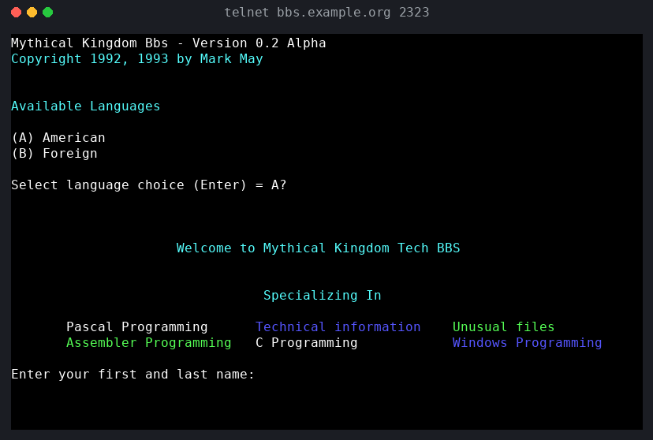
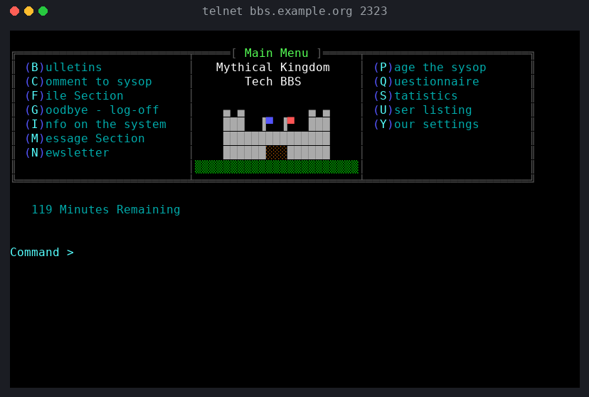
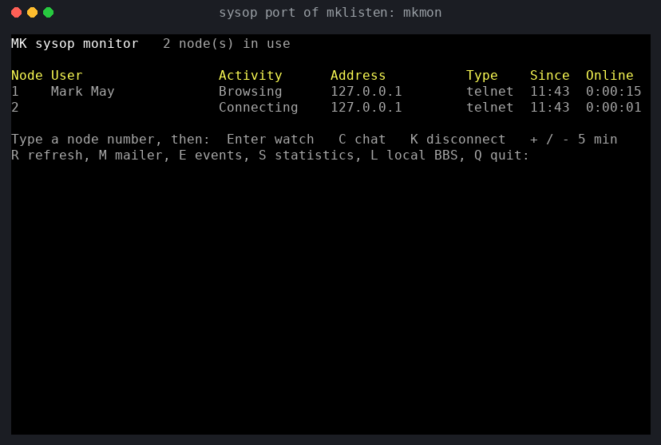
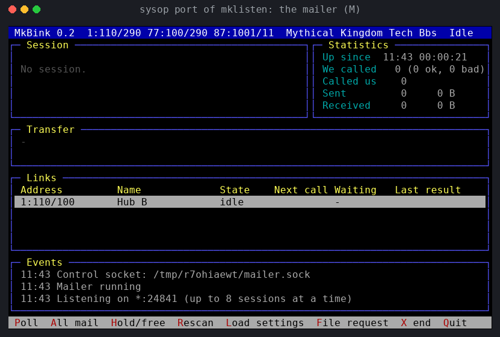
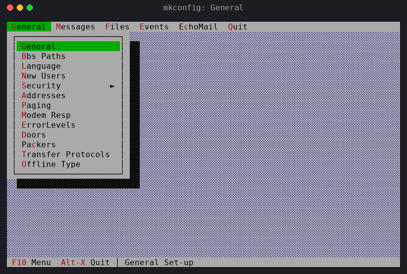
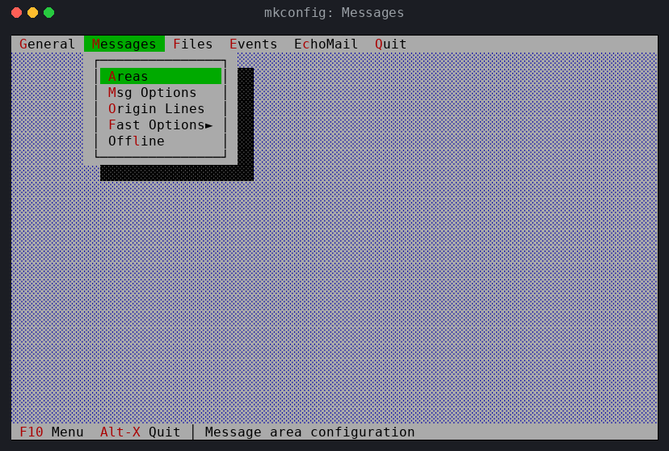
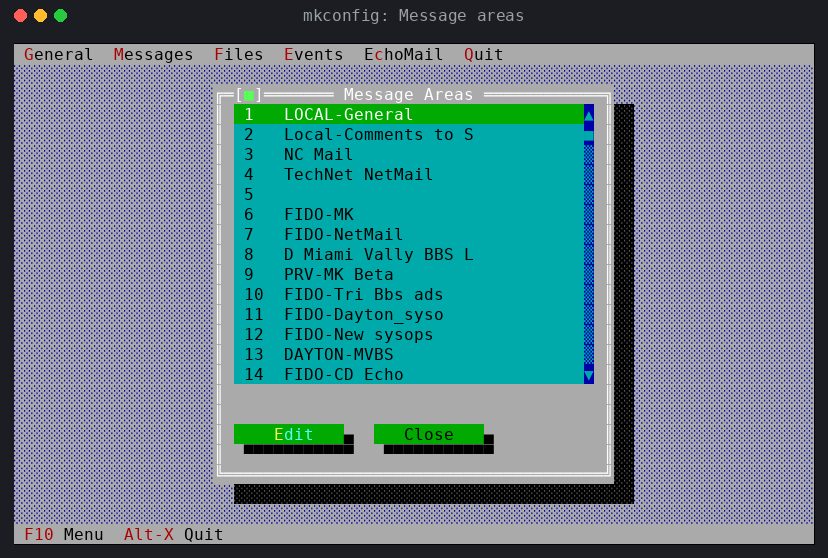

# MK BBS

**Mythical Kingdom BBS** by Mark May, brought from DOS and Turbo Pascal to **Linux and Free Pascal**.  A complete bulletin board system: callers connect over the network (Telnet, SSH, raw TCP, web socket, TLS),
read and post messages, upload and download files, play doors, and take their mail away as QWK packets; the sysop runs it with full-screen editors and a live monitor, and ties it into Fido and QWK networks.

| | |
|---|---|
|  |  |

*A caller's view over Telnet: language choice and logon, then the main menu (the screens are ordinary ANSI files; the sample BBS in this repository is the original DOS-era Mythical Kingdom Tech BBS, the board that ran on this software).*

## What you get

**For callers**
* **Connections:** over **IPv4 and IPv6**: Telnet (terminal type, size and character set negotiated), plain TCP, web socket, TLS (built in or `stunnel`), and SSH through OpenSSH (Dropbear is supported, less tested).  Output is CP437 for BBS terminals and UTF-8 for modern ones.
* **Logon:** name and password (plain as in the old days, or PBKDF2 hashes), new-user questionnaire, security levels and flags, time limits, account lock and password expiry, a login guard that blocks addresses after repeated failures.
* **Menus and screens:** every menu is a file of commands with keys and security levels; screens are ANSI, AVATAR or ASCII; all prompt text comes from language files, so a board can speak several languages.  Display codes put the caller's name, the system's numbers, and **live statistics** (`^T`: calls today, minutes this month, busiest hour ...) into screens and prompts.
* **Messages:** read, scan, reply, post and search in public and private areas, netmail, echomail and QWK conferences.  Many message base formats side by side: **Hudson, Squish, JAM, Fido `*.MSG`, Merlin, Ezycom, PCBoard, Synchronet (SMB)** and QWK.
* **Files:** file areas with lists, searches and new-file scans; upload and download with **built-in Zmodem, Ymodem, Ymodem-G and Xmodem**, or external protocols.  Uploads can be **tested, virus scanned (ClamAV or any scanner), described from `FILE_ID.DIZ` and quarantined**, all in a sandbox.
* **Offline mail:** QWK, QWKE, Bluewave and text packets, with screens, bulletins and a new-files list; replies come back as REP packets.
* **Doors:** menu command 7 runs any program with `DORINFO1.DEF`, `DOOR.SYS`, `CALLINFO.BBS` and **`DOOR32.SYS`**; command 172 runs doors described in `doors.cfg`, **DOS doors in dosemu2** (no helper script) or native programs, **each in a bubblewrap sandbox** (no network, a private `/tmp`, only its own directories).  A BASIC and a Pascal interpreter run programs inside the BBS.
* Paging, chat, bulletins and questionnaires, as the menus are set up.

**For the sysop**
* **`mklisten`** is the front door: it accepts connections on any number of ports, starts one `mk` per caller, runs scheduled **events** (polls, hub passes, purges, backups, your own commands, with exclusive maintenance windows), the **binkp mailer**, and the login guard.  It runs as a systemd service.
* **`mkmon`**, the sysop monitor on a port of its own: who is on and what they are doing, watch or type into a node, chat, disconnect, add time, the mailer, events and statistics.
* **Full-screen editors:** `mkconfig` (the whole configuration), `mkmenu`, `mkdraw` (ANSI screens), `mkusered`.  A first-run wizard `mksetup` makes a working BBS in one step and `mkcheck` tells you what would stop it from running well.
* **Housekeeping:** `mkmaint` (purge and pack message bases), `mkmsgconv` (move an area to another base kind), `mkuserpurge` and `mkuserpack`, `mkfilecheck`, `mkbackup` and restore, `mkstats` and call statistics.
* **A read-only JSON API** over HTTP(S) with scoped tokens: status, nodes, events, mailer, statistics, calls, message and file areas, messages, users; and **QWK packets over HTTPS** for hub-and-node links between MK systems.

**Networking**
* **Fido (FTN):** a binkp mailer (the separate `mkbink` project), the tosser `mktoss`, nodelists, file requests, **TIC file echoes**, a scan high-water mark.
* **QWK networks:** the board can be a node or a hub; transports are Telnet scripts (Synchronet and others), FTP, FTPS, HTTPS, or your own programs; conference helpers, control messages, ledgers that keep messages from bouncing back.

| | |
|---|---|
|  |  |

*The sysop port of `mklisten` shows `mkmon`: two callers on the nodes (left), and the binkp mailer with its session, statistics, links and event log (right, key `M`).*

| | | |
|---|---|---|
|  |  |  |

*`mkconfig`, the configuration editor: menus, message areas, file areas, events and echomail settings in a full-screen text interface (it also reads and converts Remote Access, QuickBBS and SuperBBS configurations).*

## Quick start

Install the Debian package (`sudo apt install ./mkbbs_*.deb`; it puts the programs in `/usr/bin`, makes the `mkbbs` user and the systemd unit, and starts nothing).  Doors that run in dosemu2 need `dosemu`; the door sandbox needs `bubblewrap` (the package recommends it).  To build from source instead, see the postscript.

```sh
sudo -u mkbbs mksetup -d /opt/bbs -u      # a first BBS: folders, configuration, areas, menus, screens, mklisten.json
mkcheck -c /opt/bbs                        # what would stop it from running (or running well)?
mklisten -c /opt/bbs/mklisten.json         # or: systemctl enable --now mklisten
telnet localhost 2323                      # a caller
```

`MK=<config dir> mk -L` runs the BBS locally on your own terminal for a first look.  The full path from nothing to a networked board is in [`GETTING-STARTED.md`](GETTING-STARTED.md).

## Documentation

| | |
|---|---|
| [`GETTING-STARTED.md`](GETTING-STARTED.md) | how the pieces fit, and the steps from nothing to a networked BBS |
| [`MKBBS.md`](MKBBS.md) | the BBS itself: what a caller gets, the files, every program of the toolkit |
| [`MKLISTEN.md`](MKLISTEN.md) | the listener: ports, nodes, the sysop monitor, the mailer, events, the login guard |
| [`SETUP.md`](SETUP.md) | `mksetup` and `mkcheck` |
| [`NETWORKING.md`](NETWORKING.md), [`TOSSER.md`](TOSSER.md), [`HUBS.md`](HUBS.md) | Fido, QWK networks, the tosser, hub profiles |
| [`UPLOADS.md`](UPLOADS.md) | uploads: command 173, `uploads.cfg`, tests, virus scanner, quarantine |
| [`DOS-DOORS.md`](DOS-DOORS.md) | doors: `doors.cfg`, DOS doors in dosemu2, `DOOR32.SYS`, the sandbox |
| [`API.md`](API.md) | the JSON API |
| [`SSH.md`](SSH.md), [`PASSWORDS.md`](PASSWORDS.md) | SSH access, hashed passwords |
| [`MAINT.md`](MAINT.md), [`BACKUP.md`](BACKUP.md), [`STATS.md`](STATS.md) | housekeeping, backups, statistics |

## License

GPL-3.0-or-later, see [`LICENSE`](LICENSE).  Original MK BBS © 1992, 1993 Mark May.

---

## Postscript: version, status and development

The DOS versions were numbered 0.01; **0.2 is the first version of the Free Pascal / Linux port.**  This is alpha software: the board runs, the tests pass (`./build.sh`), and the features described above are built, but it has had little time on the open internet.

### Building from source

You need Free Pascal 3.2.2 (`fpc`), `make`, and for TLS a system OpenSSL.

```sh
make && sudo make install          # programs in /usr/local/bin, the mkbbs user, a systemd unit
make deb                           # or a Debian package: build/mkbbs_<version>_<arch>.deb
```

### Building and testing

`./build.sh` builds every program into `build/` and runs the whole test suite (several hundred checks over real Telnet sessions, pseudo terminals and fake network peers); a full run takes about ten minutes.  `./build.sh --build-only` just builds.
The screenshots above are made by `tools/screenshots.py` from the real programs running on the sample BBS (it needs `pip install pyte pillow`).

### Design notes and to-do list

The `*-PLAN.md` files are design notes for the larger features, and [`MAINTENANCE-PLAN.md`](MAINTENANCE-PLAN.md) holds the to-do list (metrics, multi-node chat).
